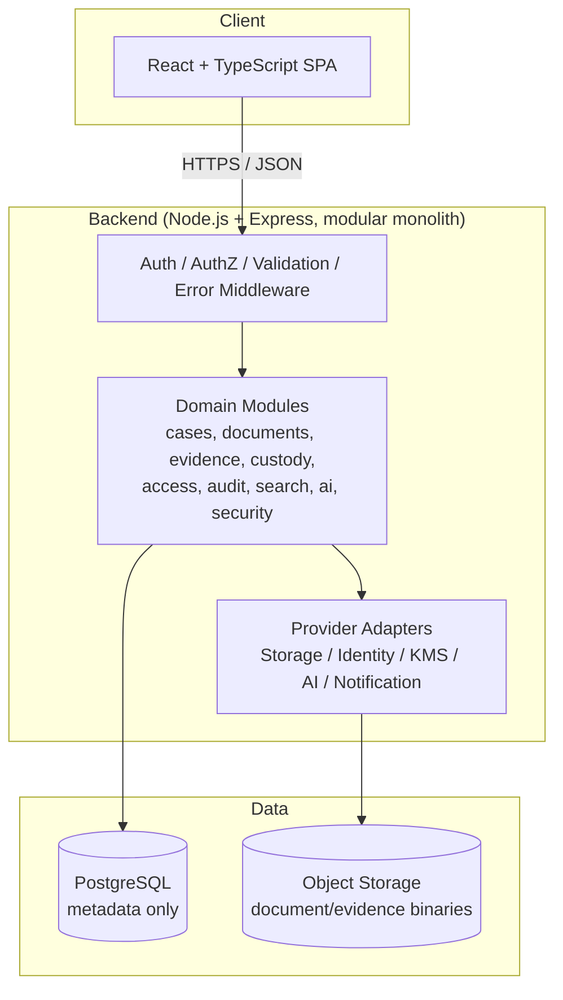
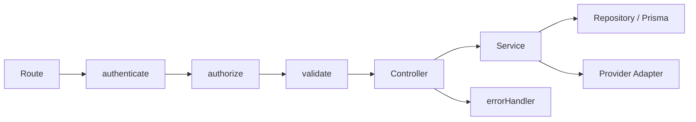
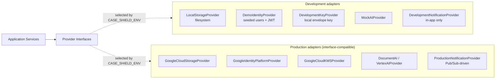
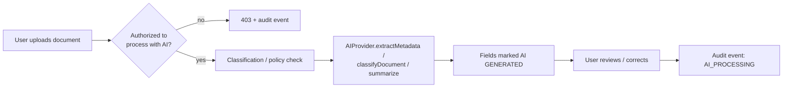
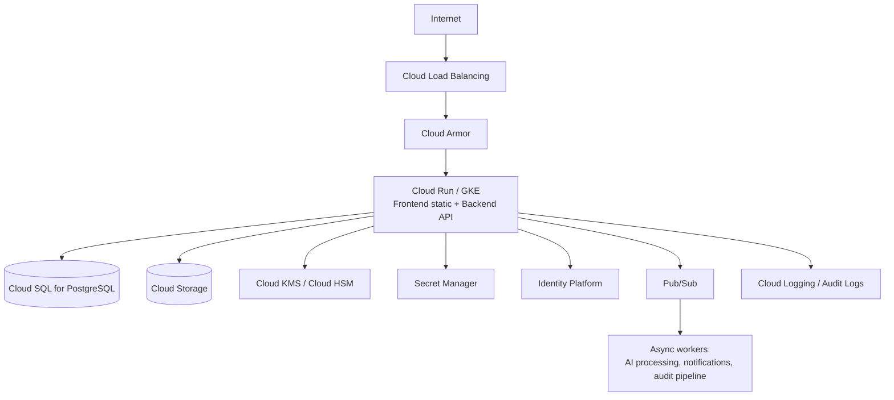
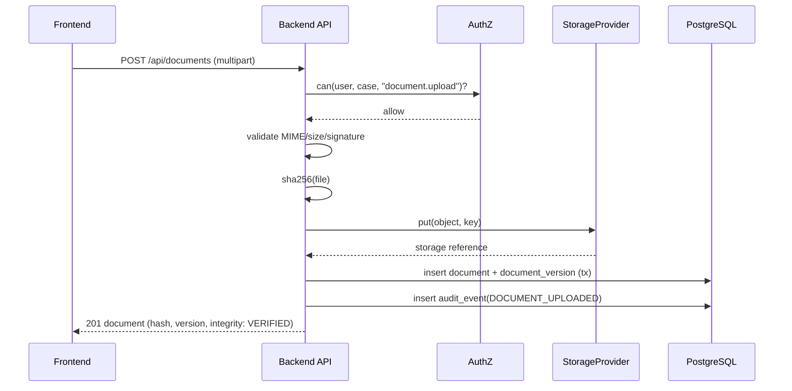

# Case Shield — Architecture

## 1. Style: Modular Monolith

One frontend, one backend (organized into domain modules), one PostgreSQL
database, one storage abstraction, one audit system, one event mechanism.
Modules are cohesive enough to be extracted into services later if scale
demands it, but the prototype deliberately avoids microservice overhead.

```
backend/src/modules/
  auth users organizations cases documents evidence custody
  access audit notifications search ai security storage
```

Each module owns its `routes/`, `controller`, `service`, `schemas`
(Zod), and `repository` (Prisma queries) — no module reaches into another
module's repository directly; cross-module calls go through the other
module's service.

## 2. High-Level Architecture



## 3. Frontend Architecture

React + TypeScript + Vite + Tailwind CSS, React Router for routing,
TanStack Query for server state/caching, React Hook Form + Zod for forms and
client-side validation (a UX convenience only — the server re-validates and
re-authorizes everything). Structure:

```
frontend/src/
  components/   shared UI primitives (StatusBadge, DataTable, Timeline...)
  layouts/      AppLayout (sidebar/topbar/breadcrumbs), AuthLayout
  pages/        route-level screens
  features/     feature-scoped hooks/components (documents, evidence, cases)
  hooks/        cross-cutting hooks (useAuth, usePermission)
  services/     typed API client
  lib/          utilities (formatting, date, file)
  types/        shared TypeScript types (mirrors backend DTOs)
  routes/       route configuration + role-aware guards
```

The frontend never decides authorization on its own; it hides controls a
user cannot use for UX clarity, but every action is re-checked server-side.
A hidden "Download" button is a UX nicety, not a security control.

## 4. Backend Architecture

Node.js + TypeScript + Express + Prisma ORM + PostgreSQL. Layering inside a
module: `routes → middleware → controller → service → repository → Prisma`.
Cross-cutting middleware: `requestId`, `authenticate`, `authorize(resource,
action)`, `validate(zodSchema)`, `errorHandler`.



## 5. Database Architecture

See `docs/database.md` for the full entity model. PostgreSQL stores
**metadata only** — case records, document/evidence metadata, permissions,
audit events. Document and evidence **binaries never touch PostgreSQL**;
they live in object storage (local filesystem in development, Google Cloud
Storage in production), referenced by a storage key on the metadata row.

## 6. Storage Architecture



The application never imports a concrete provider directly — only the
interface in `backend/src/modules/storage/types.ts` (and the analogous
files for identity/KMS/AI/notifications). A factory
(`backend/src/config/providers.ts`) selects the concrete implementation from
`CASE_SHIELD_ENV`. Business logic is identical in both modes.

Production storage design intent (not exercised without real GCP
credentials in this prototype): private buckets, backend-mediated access
(short-lived signed URLs issued by the backend after authorization, never
long-lived public links), CMEK via Cloud KMS, object versioning, explicit
per-document-class lifecycle/retention rules, and soft-delete where
appropriate. Objects are **not automatically immutable** — retention and
legal-hold are explicit, policy-driven states on the document/evidence
record, never an implicit property of "being in the bucket."

## 7. Security Architecture

See `docs/security-architecture.md` for the full threat model. In brief:
authentication (session/JWT, MFA-ready), RBAC + case/document-level ABAC
authorization evaluated server-side, input validation via Zod on every
mutating endpoint, secure headers (Helmet), rate limiting, structured
audit logging, SHA-256 integrity verification, signature-readiness without
faking a legally valid signature, and secrets sourced from environment
variables / Secret Manager — never source code.

## 8. AI Architecture



`AIProvider` is an interface with `extractMetadata`, `classifyDocument`,
`summarizeDocument`, and `semanticSearch`. Development uses
`MockAIProvider` (deterministic heuristic extraction, no network calls).
Production points at Document AI / Vertex AI. AI output is always
attributed, always editable, and never auto-applied to legal fields like
case status or charges. AI search still runs through the same
authorization filter as regular search — it can never surface a document
the caller isn't allowed to know exists.

## 9. Deployment Architecture (Reference: Google Cloud)



Government/public-sector deployment: the same architecture is designed to
be redeployable into an approved Indian government or public-sector cloud
environment, subject to that environment's own procurement, security
assessment, and data-governance requirements. The application does not
hardcode Google-specific behavior into business logic — only into the
adapter implementations — for this reason.

## 10. Key Data Flows

### Document upload



### Evidence custody transfer

```mermaid
sequenceDiagram
    participant FE as Frontend
    participant API as Backend API
    participant Auth as AuthZ
    participant DB as PostgreSQL

    FE->>API: POST /api/evidence/:id/transfers {toUserId, reason}
    API->>Auth: can(user, case+evidence, "evidence.transfer") + is custodian?
    API->>Auth: recipient eligible? (active, same org, case access, evidence.receive)
    API->>DB: SELECT evidence FOR UPDATE (tx)
    API->>DB: insert evidence_transfer(PENDING), status=TRANSFERRED
    API->>DB: append hash-linked custody_event(TRANSFERRED)
    API->>DB: insert audit_event(EVIDENCE_TRANSFER_INITIATED)
    API-->>FE: 201 evidence (custodian unchanged, pending receipt)
    Note over FE,DB: Recipient: POST /transfers/:tid/accept -> RECEIVED event,<br/>custodian changes only now; previous custodian notified
```

See §14 for the full Phase 3 evidence and chain-of-custody design.

### Audit event emission

Every service method that performs a sensitive action calls
`AuditService.record({actor, action, resource, caseId, documentId?,
result, reason?, correlationId})` inside the same DB transaction as the
business mutation where practical, so the audit record and the state
change succeed or fail together. Audit events are insert-only; there is no
update/delete route or repository method for `audit_events`.

## 11. Blockchain Stance

Blockchain is **not** a dependency of this implementation. Integrity is
provided by SHA-256 hashing, versioning, retention, the append-only audit
trail, and (Phase 3) an application-level hash-linked custody chain —
which is *not* a blockchain. If a future iteration wants tamper-evidence anchored outside
the application's own database, the only architecturally sound addition is
an **optional adapter that anchors hashes/provenance externally** — never
storage of sensitive legal documents on-chain.

## 12. Explicit Non-Overengineering Notes

No microservices, no message-bus-per-module, no premature CQRS, no bespoke
query language. Pub/Sub is reserved for genuinely asynchronous work (AI
processing, notification fan-out, audit pipeline shipping) that the request
thread shouldn't block on — not for synchronous domain calls.

## 13. Phase 2 — Privacy, Derivatives & Controlled Sharing

New modules follow the existing modular-monolith pattern (routes → service
→ `can()` → Prisma / `getStorageProvider()`):

```
backend/src/modules/privacy/
  pii/            PiiDetectionProvider interface, deterministic provider,
                  Verhoeff, masking, keyed fingerprints, provider factory
  extraction/     text extraction (pdfjs-dist for PDF text layers, UTF-8 text)
  processing/     DocumentProcessor interface + PDF / plain-text processors
                  (redaction by reconstruction, overlay watermarking)
  privacy.service.ts / privacy.routes.ts   (mounted under /api/documents)
backend/src/modules/sharing/
  share-policy.ts (pure access policy), share-purposes.ts,
  sharing.service.ts / sharing.routes.ts   (mounted at /api/shares)
```

### Data flow: scan → redact → share → recipient access

```
Document version (original, immutable)
  └─ read + SHA-256 re-verified
       ├─ extract text → detect PII → pii_scans / pii_findings (masked + HMAC only)
       ├─ reviewer selects findings → re-locate + fingerprint check
       │     → processor.redact → verify output → derived/redacted/{id} + document_derivatives
       └─ share request (purpose, window, download, redaction, watermark, approval)
             → PENDING → approved by someone other than the requester → APPROVED
             → recipient GET /api/shares/:id/{view|download}
                  → evaluateShareAccess() on every call (recipient, tenant, status, window, download)
                  → base = redacted copy or verified original
                  → dynamic watermark (recipient, purpose, timestamp, case/doc IDs)
                  → derived/watermarked/{id} (shareId-linked, hashed) → streamed, no-store
```

Storage: all derived objects go through the existing `StorageProvider`.
`STORAGE_PROVIDER` (optional, `local | gcs`) can now override the
`CASE_SHIELD_ENV` default; local storage keeps working with no cloud
credentials.

Status: deterministic PII detection, PDF/text redaction, PDF/text
watermarking and controlled sharing are **implemented**. OCR, Office
formats, an AI/NLP PII provider, cross-organization sharing and a
scheduled expiry sweep are **future** work. See
`docs/security-architecture.md` §17–§21.

## 14. Phase 3 — Evidence Management & Chain of Custody

Status legend: **IMPLEMENTED** (in code, tested) · **PROTOTYPE** (works,
known simplifications) · **FUTURE** (designed for, not built).

### 14.1 Where evidence lives — IMPLEMENTED

Evidence is a case-scoped entity (`evidence`, `backend/src/modules/evidence/`)
inside the existing modular monolith; there is no separate evidence
service or global evidence experience. The UI lives inside the Case
Workspace (**Evidence** tab → `/cases/:caseId/evidence/:evidenceId`).

```
Case ──< Evidence ──> (optional) Document → DocumentVersion → StorageObject
            │
            ├──< CustodyEvent   (append-only, hash-linked, sequence 1..n)
            ├──< EvidenceTransfer (PENDING → ACCEPTED/REJECTED/CANCELLED)
            └──< AuditEvent
```

Digital evidence **references** an immutable document version; the file is
never copied into PostgreSQL or duplicated in storage. Physical evidence is
metadata only.

### 14.2 Module layout — IMPLEMENTED

| File | Role |
|---|---|
| `evidence-lifecycle.ts` | Pure state machine: which action may follow which status |
| `custody-chain.ts` | Pure canonical serialization, SHA-256 event hashing, chain verification |
| `evidence-policy.ts` | Pure per-item policy: visibility, allowed actions, transfer-target validation |
| `evidence.service.ts` | Orchestration: authorization, row locking, chain append, audit, notifications |
| `evidence.routes.ts` / `evidence.schemas.ts` | HTTP surface + zod validation |

The same `allowedEvidenceActions()` result drives both API enforcement and
the `allowedActions` array returned to the UI, so the UI never offers an
action the server would refuse.

### 14.3 Lifecycle — IMPLEMENTED

```
REGISTERED ─┬─ TRANSFERRED(pending) ─ RECEIVED ─> IN_CUSTODY / SEALED
            ├─ EXAMINED ─> UNDER_EXAMINATION
            ├─ SEALED ⇄ UNSEALED
            └─ SUBMITTED ─> SUBMITTED_TO_COURT ─ RETURNED ─> RETURNED ─ ARCHIVED (terminal)
```

Rejected/cancelled transfers restore the status recorded on the transfer.
A sealed item stays sealed through a hand-over. `VIEWED` and `VERIFIED`
entries never change state. Invalid transitions return `409
INVALID_TRANSITION` and are audited as `DENIED`.

### 14.4 Concurrency — IMPLEMENTED

Every custody mutation runs in a transaction that first takes
`SELECT … FOR UPDATE` on the evidence row, so two requests can never both
append sequence N+1 or both open a transfer. A unique index on
`(evidenceId, sequence)` and a partial unique index (one `PENDING`
transfer per evidence item) back this up in the database.

### 14.5 Scoped audit trail — IMPLEMENTED

`GET /api/audit` no longer relies on a role-level gate. `AuditService.scopeFor()`
evaluates `can(audit.view)` per case (role baseline **or** case-level
grant). Admin/Auditor get organization-wide scope; everyone else only sees
events of cases they may audit. Every audit event now carries a
server-derived `organizationId`.

### 14.6 Future Hyperledger integration — FUTURE (not implemented)

Hyperledger Fabric is **not** implemented. The intended role is narrow:
periodically anchor custody **chain heads** (`evidence.custodyHeadHash`)
and document hashes to an external ledger so that a consistent rewrite of
the whole chain inside PostgreSQL would also be detectable. Documents and
sensitive content would never be written to a ledger. This would be an
optional adapter behind an interface, like the storage and KMS providers.
