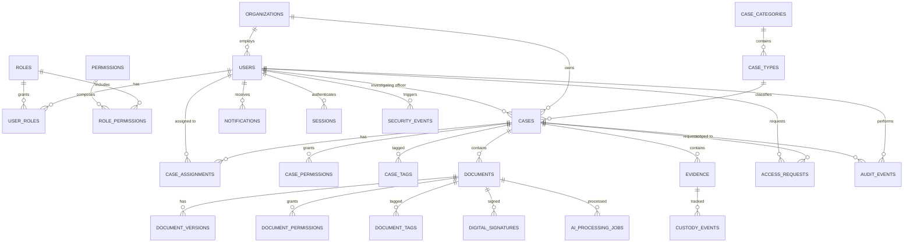

# Case Shield — Database Documentation

PostgreSQL via Prisma ORM. UUID primary keys, `created_at`/`updated_at` on
all tables, `created_by`/`updated_by` where an actor applies, soft-delete
(`deleted_at`) on user-facing entities that must never hard-delete
(cases, documents, evidence). Audit and custody tables are append-only —
no update/delete path exists in the repository layer.

## 1. Entity-Relationship Overview

## 2. Core Tables

### users
`id, organizationId, email (unique), fullName, officialIdentifier,
department, passwordHash, mfaEnabled, status (ACTIVE/SUSPENDED), lastLoginAt,
createdAt, updatedAt, deletedAt`

### organizations
`id, name, type, createdAt, updatedAt`

### roles / permissions / role_permissions / user_roles
Configuration-driven RBAC baseline. `permissions.key` uses the
`resource.action` convention (`case.view`, `document.download`,
`evidence.register`, `access.approve`, `audit.view`, ...).

### case_categories / case_types
Configurable classification hierarchy (Court/Forum is a field on `cases`;
Category → Type is a two-level table pair so new categories/types don't
require code changes).

### cases
`id, caseNumber (unique, "CASE-2026-00427" format), title, categoryId,
typeId, court, jurisdiction, status, priority, confidentiality,
investigatingOfficerId, description, openedAt, lastActivityAt,
organizationId, createdBy, createdAt, updatedAt, deletedAt`

### case_assignments
`id, caseId, userId, roleOnCase, assignedAt, assignedBy` — the team
assigned to a case, independent of their global role.

### case_permissions / document_permissions
`id, caseId|documentId, userId|roleId, permissionKey, grantedBy, grantedAt,
expiresAt` — the ABAC override layer described in
`docs/security-architecture.md` §5.

### documents / document_versions
`documents`: `id, documentNumber ("DOC-2026-001842"), caseId, type, title,
description, confidentiality, retentionPolicyId, retainUntil, legalHold,
currentVersionId, status, createdBy, createdAt, updatedAt, deletedAt`.

`document_versions` (append-only): `id, documentId, versionNumber,
fileName, fileSize, mimeType, sha256Hash, storageProvider, storageKey,
changeNote, integrityStatus, uploadedBy, uploadedAt`.

### evidence / custody_events / evidence_transfers
Redesigned in Phase 3 — see §6.

### access_requests
`id, caseId, documentId?, requestedBy, permissionKey, reason, duration,
status (PENDING/APPROVED/REJECTED/EXPIRED/REVOKED), reviewedBy, reviewedAt,
expiresAt, createdAt`.

### audit_events (append-only)
`id, actorId, actorRole, action, resource, caseId?, documentId?,
evidenceId?, result (SUCCESS/DENIED/ERROR), reason?, ipMetadata?,
requestId, occurredAt`.

### notifications
`id, userId, type, title, body, relatedCaseId?, relatedDocumentId?, isRead,
createdAt`.

### digital_signatures
`id, documentId, versionId, signerUserId, status (NOT_SIGNED/PENDING/
SIGNED/SIGNATURE_INVALID/SIGNATURE_REVOKED), certificateReference,
algorithm, signedAt, verificationStatus` — populated by the signature
abstraction; no cryptographically valid signing is performed in this
prototype (see architecture doc).

### ai_processing_jobs
`id, documentId, jobType (CLASSIFY/EXTRACT/SUMMARIZE/OCR), status, result
(JSON, fields marked aiGenerated: true), requestedBy, createdAt,
completedAt`.

### document_tags / case_tags
Simple `(caseId|documentId, tag)` join tables for filtering.

### sessions
`id, userId, tokenHash, issuedAt, expiresAt, revokedAt, ipMetadata,
userAgent`.

### security_events
`id, type (FAILED_LOGIN/SUSPICIOUS_ACCESS/INTEGRITY_VIOLATION/
UNUSUAL_DOWNLOAD/PERMISSION_CHANGE/EXPIRED_ACCESS/POLICY_VIOLATION),
userId?, caseId?, documentId?, severity, detail, occurredAt, resolvedAt`.

### retention_policies
`id, name, description, defaultRetentionDays?, allowsLegalHold`.

## 3. Indexing Notes

B-tree indexes on all foreign keys, `cases.caseNumber`,
`documents.documentNumber`, `evidence.evidenceNumber`,
`audit_events.(caseId, occurredAt)`, `audit_events.(actorId, occurredAt)`,
`notifications.(userId, isRead)`. Full-text (`tsvector`) index on
`cases.title`/`documents.title` for the PostgreSQL search implementation
described in `docs/architecture.md` §8, sized to be replaced by a
dedicated search index later without a schema rewrite.

## 4. Transaction Boundaries

Document upload (document + version + audit event), custody transfer
(custody event + evidence.currentCustodian update + audit event), and
access-request approval (access_request update + case/document_permission
insert + audit event + notification) are each written inside a single
Prisma `$transaction` so partial writes cannot occur.

## 5. Phase 2 Tables (migration `20260925151920_phase2_pii_redaction_sharing`)

All tables use UUID primary keys with foreign keys and indexes, following
the existing conventions. No raw PII is stored in any of them.

### pii_scans
One scan of one immutable `document_versions` row:
- `status`: `RUNNING | COMPLETED | FAILED | UNSUPPORTED`
- `provider`, `textLayer`, `pageCount`, `findingCount`
- `limitations` (JSON), `statusReason`
- `requestedById`, `startedAt` / `completedAt`

Indexed on `(documentId, startedAt)`.

### pii_findings
Safe metadata only:
- `type` (`AADHAAR_LIKE | PHONE_NUMBER | EMAIL_ADDRESS | IP_ADDRESS | ADDRESS_LIKE`)
- `confidence` (`LOW | MEDIUM | HIGH`)
- `pageNumber`, `startOffset` / `endOffset`
- `maskedPreview`, `detectionMethod`
- `fingerprint`: a keyed HMAC-SHA256 of the normalized value

The raw value is never stored. Cascades with its scan.

### document_derivatives
A generated copy of a version:
- `type`: `REDACTED | WATERMARKED`
- `status`: `PENDING | COMPLETED | FAILED | UNSUPPORTED`, with `statusReason`
- `sourceVersionId`
- `parentDerivativeId`: e.g. a watermark applied over a redacted copy
- storage: `storageProvider`, `storageKey` (under `derived/…`),
  `fileName`, `mimeType`, `fileSize`, `sha256Hash`
- `piiScanId`
- `redactionMetadata` / `watermarkMetadata` (JSON: counts by type, method,
  verification result, notes; recipient, purpose, copy reference)
- `shareId`: set for copies delivered through a share
- `createdById`, `createdAt`

Indexed on `(documentId, createdAt)`, `sourceVersionId` and `shareId`.
The original `document_versions` row and object are never modified.

### document_shares
Controlled sharing of one version to one recipient:
- document: `documentId`, `caseId`, `sourceVersionId`
- parties: `requestedById`, `recipientUserId`, `recipientOrganization`
- purpose: `purpose` (enum `SharePurpose`), `purposeNote`
- window: `startsAt`, `expiresAt`
- options: `allowDownload`, `applyRedaction` + `baseDerivativeId`,
  `applyWatermark`, `requireApproval`
- `status` (reuses `AccessRequestStatus`:
  `PENDING | APPROVED | REJECTED | EXPIRED | REVOKED`)
- review: `reviewedById`, `reviewedAt`, `reviewNote`
- revocation: `revokedById`, `revokedAt`

Indexed on `(recipientUserId, status)`, `(documentId, status)` and
`caseId`.

### audit_events (extended)
New nullable `metadata JSONB` column for safe structured context. Values
are PII-masked by `AuditService` before insert. The table remains
append-only.

### New permissions
`document.scan` and `document.redact` are granted to INVESTIGATOR,
SENIOR_INVESTIGATOR and FORENSIC_OFFICER. Re-run `npm run prisma:seed` to
upsert them.

## 6. Phase 3 Tables (migration `20260925170000_phase3_evidence_chain_of_custody`)

The migration is hand-edited so existing rows survive: enum values are
remapped (not blindly cast), `integrityHash → originalHash` and
`authorizedBy → actorId` are renamed, custody events are numbered with
`ROW_NUMBER()`, and `audit_events.organizationId` is back-filled from the
case (or actor). Custody hashes for pre-existing events are **not**
computed in SQL; `npm run prisma:seed` seals such legacy chains once
(`sealLegacyCustodyChains` block in `prisma/seed.ts`). Until then they
verify as `UNSEALED_EVENT`.

### evidence
`id, evidenceNumber (EVD-YYYY-NNNNN, unique), caseId → cases, title, type
(string; catalog in evidence.schemas.ts: DOCUMENT, PHOTOGRAPH, VIDEO,
AUDIO, FORENSIC_REPORT, DIGITAL_EVIDENCE, PHYSICAL_EVIDENCE, DEVICE,
BIOLOGICAL_SAMPLE, OTHER), description, source?, collectedById → users,
collectedAt, location?, registeredById → users, currentCustodianId →
users, status (EvidenceStatus), confidentiality, notes?,
originalDocumentId → documents?, originalVersionId → document_versions?,
originalHash?, currentHash?, integrityStatus?, lastVerifiedAt?,
custodyHeadHash?, custodyEventCount, submittedAt?, lastActivityAt,
createdAt, updatedAt, deletedAt?`. `storageKey` is a legacy, unused column.

`type` is a string so categories can be added without a migration.
Indexes: `(caseId)`, `(caseId, status)`, `(currentCustodianId)`,
`(originalDocumentId)`.

`EvidenceStatus`: `REGISTERED, IN_CUSTODY, UNDER_EXAMINATION, TRANSFERRED
(pending receipt), SUBMITTED_TO_COURT, RETURNED, SEALED, ARCHIVED`.
Phase 1 values were mapped `COLLECTED→REGISTERED`, `IN_TRANSIT→IN_CUSTODY`
(no transfer row existed to accept), `SUBMITTED→SUBMITTED_TO_COURT`,
`RELEASED→RETURNED`.

### custody_events (append-only, hash-linked)
`id, evidenceId → evidence, sequence (unique per evidence), fromUserId?,
toUserId?, action (CustodyAction), reason, notes?, location?, actorId →
users, organizationId, transferId → evidence_transfers?, hashAtEvent?,
occurredAt (server time), previousEventHash?, eventHash?`.

`CustodyAction`: `COLLECTED (legacy), REGISTERED, TRANSFERRED, RECEIVED,
TRANSFER_REJECTED, TRANSFER_CANCELLED, EXAMINED, SEALED, UNSEALED,
SUBMITTED, RETURNED, ARCHIVED, VIEWED, VERIFIED`.

No code path updates or deletes custody events.

### evidence_transfers
`id, evidenceId → evidence, fromCustodianId, toCustodianId, initiatedById
(→ users), reason, notes?, status (PENDING/ACCEPTED/REJECTED/CANCELLED),
previousStatus, responseNote?, initiatedAt, respondedAt?`.
A partial unique index (`evidence_transfers_one_pending_per_evidence`)
allows at most one `PENDING` transfer per evidence item.

### audit_events (extended)
`+ organizationId` (derived server-side), and `evidenceId` now has a
foreign key to `evidence`. New indexes `(evidenceId, occurredAt)` and
`(organizationId, occurredAt)`.

### notifications (extended)
`+ relatedEvidenceId` — lets the UI link "Review" to the evidence page.
New `NotificationType` value `EVIDENCE_TRANSFER_REJECTED`.

### Transaction boundaries (Phase 3)
Every custody mutation: `BEGIN → SELECT evidence FOR UPDATE → state
checks → insert custody_event (+ transfer) → update evidence head/status
→ insert audit_event → COMMIT`. Notifications are sent after commit.

### Demo data
`CASE-2026-00427` gets `EVD-2026-00041` (Forensic Examination Report,
linked to `DOC-2026-001842` v1; Forensic Officer → Senior Investigator →
Prosecutor), `EVD-2026-00042` (Scene Photograph Set; sealed, transferred,
unsealed, examined), `EVD-2026-00043` (Digital Evidence Package; transfer
to the Forensic Officer **pending receipt**) and the legacy
`EVD-2026-00091`. The Prosecutor is now assigned to that case. All data is
fictional.
