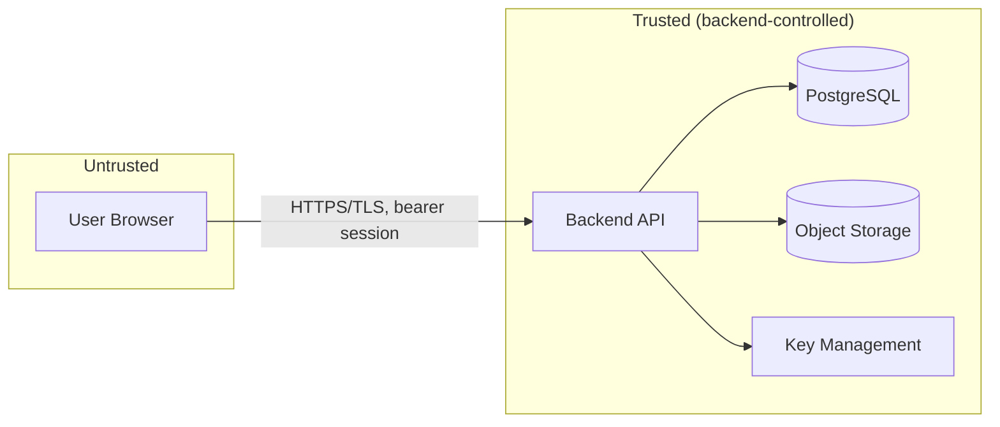

# Case Shield — Security Architecture

This document describes the security controls implemented (or structurally
prepared) in this prototype, and is deliberately honest about residual
risk. It is not a certification, and this system has not undergone
independent security assessment.

## 1. Assets

- Case metadata (may reveal ongoing investigations)
- Document and evidence binaries (FIRs, forensic reports, witness
  statements, media)
- Chain-of-custody records
- Audit trail
- User credentials and session tokens
- Encryption/signing keys (production: Cloud KMS/HSM-held, never in app
  memory as raw key material)

## 2. Trust Boundaries



The browser is never trusted with authorization decisions, storage
credentials, or key material. Every role, user ID, case ID, document ID,
and permission asserted by the client is re-validated against the database
on the server for every request.

## 3. Threat Model (selected)

| Threat | Mitigation | Residual risk |
|---|---|---|
| Unauthorized case/document access | Server-side Person→Role→Org→Case→Document→Permission model, deny-by-default | Misconfigured permission grants are still possible; requires admin audit review |
| Privilege escalation via client-supplied role/IDs | Backend derives identity from session, never trusts client-asserted role/user/case/document IDs | N/A within app; a compromised session token still grants that user's real access |
| Document tampering | SHA-256 hash per version, on-demand verification | Hash proves the stored bytes match at verification time; it does not itself prove who created the original document |
| Audit tampering | Insert-only audit repository, no UI/API update or delete path | A database administrator with direct DB access could still alter rows; production should add DB-level constraints/replication to an append-only sink |
| Credential theft / brute force | Rate limiting, account lockout thresholds, MFA-ready flow | MFA is not yet mandatory-enforced in the prototype |
| File-upload attacks (malware, polyglot files) | MIME + extension + size + magic-byte signature checks; malware-scan integration point | Actual malware scanning is mocked in development; production must wire an approved scanner before go-live |
| Injection (SQL, path traversal) | Prisma parameterized queries, Zod validation, storage keys generated server-side (never from user input) | N/A absent an unreviewed raw-query addition |
| Secrets leakage | `.env` gitignored, `.env.example` only, Secret Manager in production, no keys in frontend bundle | Developer machine hygiene is outside the application's control |
| Session hijacking | HttpOnly, Secure, SameSite cookies (or short-lived JWT) in production; session table supports revocation | XSS anywhere in the app would still be dangerous; see output-encoding controls below |
| Cross-site scripting | React's default escaping, no `dangerouslySetInnerHTML` on user content, secure headers (CSP via Helmet) | Third-party component vulnerabilities are not independently audited here |
| Over-broad AI data exposure | AIService checks authorization + data classification before sending any content to a provider, logs the operation | Production must additionally confirm the AI provider's own data-handling terms before enabling on RESTRICTED material |

## 4. Authentication

Development: `DemoIdentityProvider` issues signed session JWTs for seeded
demo users (email + password, bcrypt-hashed even in the demo fixtures) and
is structurally MFA-ready (a `mfaEnabled`/`mfaVerified` claim gates
sensitive actions). Production: Google Identity Platform, behind the same
`IdentityProvider` interface — no business logic changes required.

## 5. Authorization

Two layers, both enforced server-side on every request:

1. **RBAC baseline** — a role grants a default set of permissions
   (`role_permissions`).
2. **Contextual ABAC overrides** — `case_permissions` and
   `document_permissions` grant or restrict specific users/roles on a
   specific case or document (e.g., a Prosecutor may have `document.view`
   but not `document.download` on one file, or access to Case A but not
   Case B).

Effective permission = role baseline, narrowed/widened by case-level grant,
narrowed/widened by document-level grant, always evaluated at request time
— never cached across requests in a way that would miss a revocation.

## 6. Encryption

- Transport: TLS terminated at the load balancer in production; local dev
  runs over plain HTTP for developer convenience only, and the README
  says so explicitly.
- At rest (production intent): Cloud SQL and Cloud Storage default
  encryption at rest, with **CMEK via Cloud KMS** for the storage bucket
  where required by classification, and Cloud HSM-backed keys for
  higher-assurance key protection where mandated.
- Confidentiality (encryption) is treated as a **distinct property** from
  integrity (hashing) and from authenticity (digital signatures) — see
  `docs/architecture.md` and the in-app integrity explainer. The system
  never conflates "hash verified" with "signed" or "encrypted."

## 7. Key Management

`KeyManagementProvider` interface: `DevelopmentKeyProvider` (local
envelope key for development only, clearly logged as non-production) vs.
`GoogleCloudKMSProvider` (production). No raw key material is ever
returned to the frontend or written to application logs.

## 8. Storage Security

Frontend never receives storage credentials. All reads/writes go
`Frontend → Backend API → StorageProvider → Object Storage`. Production
buckets are private; access is backend-mediated (or via short-lived signed
URLs issued after authorization). See §6 of `docs/architecture.md`.

## 9. Audit

(Phase 3: audit queries are case-scoped and every event carries a
server-derived `organizationId` — see §25.)

`audit_events` is insert-only from the application's perspective — the
repository layer exposes `create()` and `list()`/`find()` only. Every
security-sensitive action (see full list in `docs/database.md`) produces a
record with actor, role, action, resource, case/document IDs, result,
reason, timestamp, and a request correlation ID.

## 10. Integrity Verification

SHA-256 is computed at upload time and stored per document version.
Verification recomputes the hash of the currently stored object and
compares it to the registered value:

- Match → `INTEGRITY VERIFIED`
- Mismatch → `INTEGRITY VIOLATION`, which also raises a security event and
  audit entry.

This proves the stored bytes are unchanged since registration; it does not
by itself prove authorship, and it is not a substitute for a digital
signature.

## 11. AI Security

Before any AI call: (1) confirm the caller is authorized to view/process
the target document, (2) check the document's confidentiality
classification against policy, (3) log the operation (`AI_PROCESSING`
audit event) before dispatch. `MockAIProvider` performs no network calls
in development. AI output never bypasses authorization and never
determines legal outcomes.

## 12. Incident Handling (prototype-level)

Integrity violations and repeated authorization failures raise
`security_events` visible in the Security Center and are tagged for
Auditor review. This prototype does not implement automated response
(account lockout beyond basic rate limiting, SOAR integration); production
deployment would need a defined incident-response runbook and integration
with an organizational SIEM.

## 13. Backup / Recovery (production intent, not exercised here)

Cloud SQL automated backups + point-in-time recovery; Cloud Storage object
versioning for accidental-overwrite recovery. Retention and legal-hold
states are explicit fields on documents/evidence, not derived from backup
policy.

## 14. Data Retention

Every document/evidence record supports a `retentionPolicy`,
`retainUntil`, and `legalHold` flag. Nothing is auto-deleted by a generic
lifecycle rule while `legalHold = true`; deletion actions themselves are
audited and permissioned (`document.delete` / `evidence.delete` are
intentionally not granted to any default role in seed data).

## 15. Language Policy

The application and its documentation avoid unsupported claims. Approved
phrasing: "cryptographic integrity verification," "tamper-evident audit
trail," "controlled access," "immutable retention where configured,"
"designed for evidentiary integrity," "production deployment subject to
applicable legal and organizational requirements." Prohibited: "100%
legally admissible," "tamper-proof forever," "impossible to hack,"
"guaranteed court acceptance," "Government approved," any claim of
official Government of India status or endorsement.

## 16. Known Limitations of This Prototype

- MFA flow exists structurally but is not enforced by default in seed data.
- Malware scanning is mocked.
- No independent penetration test or formal threat-model review has been
  performed.
- Rate limiting and lockout thresholds are conservative defaults, not
  tuned for a specific deployment's traffic.
- Production cloud adapters are implemented against the documented GCP
  APIs but have not been exercised against live GCP credentials in this
  environment.

---

# Phase 2 — PII Protection, Redaction, Watermarking & Controlled Sharing

Status labels used below: **Implemented** (working and tested in this
repository), **Prototype** (working but deliberately limited), **Future**
(designed-for, not built).

## 17. PII Protection

### 17.1 Detection architecture — Implemented (deterministic) / Future (AI/NLP)

`backend/src/modules/privacy/pii/` defines a `PiiDetectionProvider`
interface (`detect(pages) → PiiDetection[]`, plus a per-type `coverage`
declaration). `getPiiDetectionProvider()` selects the provider from
`PII_PROVIDER`. The only provider today is
`DeterministicPiiDetectionProvider` (`deterministic-rules-v1`):

| Type | Method | Confidence rules |
| --- | --- | --- |
| Aadhaar-like | 12 digits, first digit 2–9, contiguous or 4-4-4 with one separator | Verhoeff checksum passes **and** "Aadhaar/UID" context → HIGH; one of the two → MEDIUM; neither → LOW. Never labelled "Aadhaar" — only "Aadhaar-like". |
| Phone number (IN mobile) | optional +91 / 0091 / 0, then 10 digits starting 6–9 (≤3 separators) | country code or phone context → HIGH, else MEDIUM |
| Email address | RFC 5322 subset | HIGH |
| IPv4 | valid octets, not part of longer dotted runs | network context → HIGH; version-number context → LOW; else MEDIUM |
| Address-like | **Prototype / limited** heuristic: a single line with address vocabulary plus a 6-digit PIN code or an "Address:" label | LOW / MEDIUM only; `coverage.ADDRESS_LIKE = HEURISTIC_LIMITED` |

Address detection is a separate `AddressDetectionStrategy` so an NER/NLP
model can replace it without touching anything else. Overlapping numeric
matches (e.g. a 12-digit value that is also a +91 phone) keep the stronger
match.

**Future:** an AI/NLP provider (for example Cloud DLP or a Vertex AI NER
model) implementing the same interface. It would be selected via
`PII_PROVIDER` and could be combined with the deterministic rules.

**Detection is never described as complete.** Every scan result carries
`limitations` (for example "not exhaustive", "address detection is
heuristic", "PDF contains images; OCR not implemented"). A human reviews
the findings before anything is redacted.

### 17.2 Handling of detected values — Implemented

- Raw values exist **only in memory** during a request (`PiiDetection.value`).
- `pii_findings` stores type, confidence, page, character offsets, masked
  preview, detection method and a **keyed HMAC-SHA256 fingerprint**. The key
  is `PII_FINGERPRINT_SECRET`, or derived from `JWT_SECRET` when that is
  unset. It is never hardcoded. A plain hash is not used because 12-digit
  identifiers are brute-forceable.
- API responses return masked previews only (`XXXX XXXX 1234`,
  `XXXXXX3210`, `c***@e***.org`, `203.XXX.XXX.XXX`,
  `[address-like text, 68 chars, PIN 9XXXXX]`). Offsets and fingerprints are
  not returned.
- Nothing logs extracted text or detected values. The test logger is silent.
- **Audit defence in depth:** `AuditService.record()` passes `reason` and
  every string in `metadata` through `maskPiiInText()` before writing.
  UUIDs and SHA-256 digests are exempt. Tests assert that no fixture value
  appears anywhere in `audit_events`.

### 17.3 Text extraction — Implemented for PDF (text layer) and text/plain

`extraction/text-extraction.ts` uses the pdfjs-dist legacy build (text
content plus positions, with no rendering and no worker) for PDFs, and
strict UTF-8 decoding for text files. Scanned or image-only PDFs report
`textLayer: false`. Other formats (images, audio/video, Office) report
`supported: false`, and the scan is stored as **UNSUPPORTED**, not as "no
PII found". OCR and Office extraction are **Future**.

## 18. Original vs. Derived Documents — Implemented

- The original `DocumentVersion` object is **only ever read**. Redacted and
  watermarked outputs are new objects under
  `cases/{caseId}/{documentId}/derived/{redacted|watermarked}/{derivativeId}/{file}`,
  each with a `document_derivatives` row holding its SHA-256, storage
  provider/key, creator, status and redaction/watermark metadata.
- Before deriving anything, the source bytes are re-hashed. On a mismatch
  the operation is refused, and `INTEGRITY_VIOLATION` audit and security
  events are recorded. Derived copies are also hash-checked when read.
- Tests assert that the original bytes and registered hash are unchanged
  after redaction and watermarking.

### 18.1 Redaction workflow

Scan → review masked findings → select → `POST /redactions` →

1. Re-extract the text and re-run detection. Each selected finding must be
   re-located at the same page and offsets **with the same fingerprint**,
   otherwise the redaction fails (the document or rules changed).
2. The processor produces the redacted copy:
   - **PDF — reconstruction, not overlay.** A new PDF is built from the
     extracted text items only. Redacted characters are never written, and
     a black box marks where they were. No content streams, fonts,
     annotations, attachments, metadata or images from the original are
     copied, so there is no hidden selectable text under the boxes.
     Trade-offs (**Prototype**): fonts are normalised to Helvetica, layout
     is approximate, and images and vector graphics are omitted. These are
     recorded in `redactionMetadata.notes`.
   - **text/plain** — spans are replaced with `[REDACTED: <type>]` tokens.
   - **Scanned PDFs, images, Office documents → `UNSUPPORTED`.** The
     original is untouched and nothing is claimed as redacted.
3. **Post-redaction verification:** the output is re-extracted and checked
   for each redacted value in normalized form, then re-scanned and its
   fingerprints compared. If verification fails the derivative is marked
   `FAILED` and **nothing is stored**.

Processors implement `DocumentProcessor` (`processing/`); new formats are
added by registering a processor. Formats with no processor are refused.

### 18.2 Dynamic watermarking

`PrivacyService.produceWatermarkedCopy()` stamps every page with a
translucent diagonal banner (classification · recipient · purpose) and a
footer containing the classification, case ID, document ID, recipient,
purpose, UTC access timestamp and a copy reference (the first 8 characters
of the derivative ID). Text documents are rendered to PDF first. Encrypted
PDFs are `UNSUPPORTED`. Watermarking can start from the original or from a
redacted copy (`parentDerivativeId`).

**Limitation:** a watermark is an overlay. It deters and attributes leaks
(copy reference and hash map a leaked copy back to a recipient and time),
but it is **not DRM**. A determined user can remove it or photograph the
screen.

## 19. Controlled Sharing — Implemented

### 19.1 Model

A `document_shares` row binds **one document version** to **one recipient
user** with a **purpose**, `startsAt`/`expiresAt`, `allowDownload`,
redaction (a specific COMPLETED redacted derivative of that version),
watermark and approval flags, and a status
(`PENDING | APPROVED | REJECTED | EXPIRED | REVOKED`).

**A share never creates a `document_permission` and never grants access to
the original object.** Recipients reach content only through
`GET /api/shares/:id/view` and `GET /api/shares/:id/download`, which serve a
copy produced for them. The document's own `/download` endpoint still
requires normal case and document authorization (tested).

### 19.2 Authorization — purpose is not authorization

- Create: `document.share` via `can()` (organization → role → case →
  document → action, including the explicit-grant rule for
  RESTRICTED/HIGHLY_CONFIDENTIAL). Recipients must be active users in the
  case's organization (tenant isolation) and cannot be the requester.
- Approve/reject: `access.approve` on that case, and **not the requester**
  (separation of duties).
- Revoke: the requester, or `access.revoke` / `access.approve` on the case.
- Purpose (`Investigation`, `Forensic Examination`, `Court Filing`,
  `Legal Review`, `Evidence Verification`, `Administrative Review`,
  `Other` + note) is recorded on the share, printed on watermarks and
  written to audit metadata. It never widens access.

### 19.3 Server-side policy

`sharing/share-policy.ts#evaluateShareAccess()` is a pure function. It is
applied on every view, download and detail call, and it is unit-tested:

recipient check → tenant check → revoked → rejected → pending →
expired (`now ≥ expiresAt`) → not yet started (`now < startsAt`) →
download permitted.

- Expired shares return **403 `SHARE_EXPIRED`** even if the stored status
  is still APPROVED. The status is then moved to EXPIRED, with one
  `SHARE_ACCESS_EXPIRED` audit event and an `EXPIRED_ACCESS` security
  event.
- Windows must start no more than 5 minutes in the past, end in the
  future and last at most 90 days.
- Server policy can only make a share **stricter**:
  - View-only shares are always watermarked.
  - RESTRICTED / HIGHLY_CONFIDENTIAL documents always require approval.
  - A share that requires a watermark is never served without one.
- Non-recipients receive 403 `NOT_RECIPIENT`, plus
  `UNAUTHORIZED_ACCESS_ATTEMPT` audit and `SUSPICIOUS_ACCESS` security
  events.
- Every served copy is stored as a `WATERMARKED` derivative linked to the
  share (`shareId`) with its hash. Responses are sent with
  `Cache-Control: no-store`.

**Limitation (view-only):** "view" still delivers the watermarked bytes to
the browser. Disabling download is enforced by the API and removes the
download action, but it cannot prevent a determined recipient from saving
what their browser displays. The mitigation is the mandatory watermark.

## 20. Phase 2 Audit Events — Implemented

`PII_SCAN_STARTED`, `PII_SCAN_COMPLETED`, `PII_REDACTION_CREATED`,
`WATERMARK_CREATED`, `SHARE_REQUEST_CREATED`, `SHARE_REQUEST_APPROVED`,
`SHARE_REQUEST_REJECTED`, `SHARE_ACCESS_GRANTED`, `SHARE_ACCESS_EXPIRED`,
`SHARE_ACCESS_REVOKED`, `DOCUMENT_VIEWED`, `DOCUMENT_DOWNLOADED`,
`DOWNLOAD_DENIED` (denials of the original download now use this action),
and `UNAUTHORIZED_ACCESS_ATTEMPT`.

Each event records actor, role, case, document, result, reason and
`requestId` (correlation ID). The new `metadata` JSON holds safe context
such as purpose, recipient user ID, share/derivative/scan IDs, counts by
PII type, hashes and denial codes.

## 21. Phase 2 Limitations (honest summary)

- PII detection is rule-based and **not exhaustive**. Address detection is
  a limited heuristic. There is no OCR, so text inside images and scanned
  PDFs is not scanned.
- PDF redaction reconstructs text only: layout and fonts are approximate,
  and images and graphics are dropped (stated in each copy's notes).
  Rotated or complex-script text may render imperfectly. Characters outside
  the standard PDF font appear as `?`.
- Watermarks are deterrence and attribution, not DRM.
- Recipients must belong to the case's organization. Cross-organization
  sharing is **Future**.
- Expiry is enforced on every request. There is no background job, so
  stored status changes on the next access or listing.
- Every access to a watermarked share stores a new derived copy. A
  retention/cleanup policy for delivered copies is **Future**.
- Nothing in this system guarantees legal admissibility, and no system is
  immune to compromise.

---

# Phase 3 — Evidence Management, Chain of Custody & Advanced Audit Trail

Status legend: **IMPLEMENTED** · **PROTOTYPE** · **FUTURE**.

## 22. Evidence Authorization — Implemented

Evidence follows the existing model, extended one level:

```
User → Organization → Role → Case → Evidence → Action
```

1. **Case access first.** `can()` denies everything on a case the user
   cannot access (same organization + investigating officer / assignment /
   active case grant, or an oversight role). A role alone never reaches
   evidence.
2. **Permission.** New catalog keys: `evidence.receive`, `evidence.examine`,
   `evidence.seal`, `evidence.submit`, `evidence.archive`, `evidence.verify`
   (in addition to `evidence.view/register/transfer`).
3. **Classification.** `RESTRICTED` / `HIGHLY_CONFIDENTIAL` evidence — or
   any evidence in a case with that classification — needs an explicit
   case-level grant or an oversight role.
4. **Custody.** Transfer, examine, seal/unseal, submit and return require
   being the *current custodian*. Accept/reject requires being the named
   recipient; cancel requires being the initiator. Archiving is a
   supervisory action (`evidence.archive`) that does not require custody.
5. **Court-only visibility.** A Judge (without an investigative role or an
   explicit `evidence.view` grant) sees only evidence that has been
   submitted to court.

| Role | Evidence capabilities (baseline, on accessible cases) |
|---|---|
| Investigator | view, register, initiate transfer, receive, seal, verify |
| Senior Investigator | + submit, archive, audit.view (case-scoped) |
| Forensic Officer | view, register, transfer, receive, **examine**, seal, verify |
| Prosecutor | view, transfer, receive, **submit / record return**, verify |
| Judge | view **submitted** evidence, verify, audit.view (case-scoped) |
| Auditor | view, verify, audit.view (organization-wide) |
| Admin | audit.view (organization-wide); no evidence content access |

All of this is enforced in `evidence.service.ts` / `evidence-policy.ts`.
The frontend only displays the server-computed `allowedActions`.

**Transfer recipients** must be: an existing, `ACTIVE`, non-deleted user;
in the same organization; with access to the case; holding
`evidence.receive` **and** able to view this item (classification,
court-only rule); and not the current custodian. A reason is mandatory.
Each rejection returns a specific code (`TRANSFER_SAME_CUSTODIAN`,
`TRANSFER_RECIPIENT_INACTIVE`, …) and is audited as `DENIED`.

**Server authority.** The actor always comes from the authenticated
session; custody timestamps are server-generated; the client sends an
*action*, never a status. Unknown body fields (`actorId`, `status`,
`occurredAt`) are stripped by validation and ignored.

## 23. Chain of Custody — Implemented

### 23.1 Hash-linked custody events

Each `custody_events` row stores `sequence`, `previousEventHash` and
`eventHash`:

```
event 1: eventHash = SHA-256( "" + "\n" + canonical(event 1, prev = null) )
event n: eventHash = SHA-256( prev + "\n" + canonical(event n, prev = hash(n-1)) )
```

`canonical()` is a fixed-order JSON array of: version, evidenceId,
sequence, action, from/to custodian, actor, organization, transferId,
reason, notes, location, evidence content hash at the time, server
timestamp (ms ISO), previousEventHash. The evidence row records the chain
head (`custodyHeadHash`) and length (`custodyEventCount`).

This is a **tamper-evident, application-level** mechanism. It is **not a
blockchain** and it is **not tamper-proof**.

### 23.2 Verification

`POST /api/evidence/:id/verify-custody` recomputes every hash and reports
`CUSTODY CHAIN VERIFIED` or `CUSTODY CHAIN INTEGRITY VIOLATION` with, per
failure: the event id and sequence, the expected and stored hash, and a
code:

| Code | Detects |
|---|---|
| `HASH_MISMATCH` | an event's data was edited after it was recorded |
| `BROKEN_LINK` | an event no longer links to its predecessor (edit + re-hash, insertion, reordering) |
| `SEQUENCE_GAP` | a middle event was removed |
| `HEAD_MISMATCH` | the last event(s) were removed (truncation) |
| `UNSEALED_EVENT` | an event has no hash (pre-Phase 3 row not yet sealed) |

Event content (reasons, notes) is not echoed back in the result. Results
are audited (`CUSTODY_CHAIN_VERIFIED` / `CUSTODY_CHAIN_INTEGRITY_FAILED`)
and a failure raises a CRITICAL security event.

**What it does not protect against (honest limit):** someone with direct
write access to PostgreSQL can recompute and rewrite an entire chain,
including the head fields. Detecting that requires anchoring chain heads
outside the database — the FUTURE Hyperledger adapter (§26).

### 23.3 Access logging

Every successful evidence view is audited (`EVIDENCE_VIEWED`), and a
`VIEWED` entry is appended to the custody chain at most once per user per
30 minutes (to keep the timeline readable). Denied views are audited with
result `DENIED`. Integrity verifications append a `VERIFIED` entry.

## 24. Evidence Integrity Verification — Implemented

At registration, when a document is attached, the backend **reads the
stored bytes and recomputes SHA-256**; if they no longer match the
document version's registered hash, registration is refused. The
recomputed value becomes the evidence's `originalHash` (never overwritten).

`POST /api/evidence/:id/verify-integrity` re-reads the bytes via the
storage abstraction and returns `INTEGRITY VERIFIED` or
`INTEGRITY VIOLATION` (an unreadable object is also a violation). It
records the result on the evidence row, in the custody chain and in the
audit log, and a violation raises a CRITICAL security event and notifies
the custodian and investigating officer.

SHA-256 verification shows that the stored bytes match the registered
hash. It **does not** by itself establish authorship, lawful collection or
legal admissibility.

## 25. Advanced Audit Trail — Implemented

- `GET /api/audit` filters: case, evidence, document, actor, action,
  result, date range, organization.
- Scope is resolved per case with `can(audit.view)`; Admin/Auditor are
  organization-wide; nobody can query another organization (an
  `organizationId` filter for a different org is refused).
- Filtering on a case/evidence/document outside the caller's scope returns
  `403` and is itself audited (`AUDIT_QUERY_DENIED`).
- `GET /api/audit/facets` returns filter options limited to the same scope.
- Free text (reasons) still passes through the Phase 2 PII masker.

New audit actions: `EVIDENCE_REGISTERED`, `EVIDENCE_VIEWED`,
`EVIDENCE_VERIFIED`, `EVIDENCE_TRANSFER_INITIATED`,
`EVIDENCE_TRANSFER_ACCEPTED`, `EVIDENCE_TRANSFER_REJECTED`,
`EVIDENCE_TRANSFER_CANCELLED`, `EVIDENCE_EXAMINED`, `EVIDENCE_SEALED`,
`EVIDENCE_UNSEALED`, `EVIDENCE_SUBMITTED`, `EVIDENCE_RETURNED`,
`EVIDENCE_ARCHIVED`, `CUSTODY_CHAIN_VERIFIED`,
`CUSTODY_CHAIN_INTEGRITY_FAILED`, `AUDIT_QUERY_DENIED`.

## 26. Phase 3 Status & Limitations

| Item | Status |
|---|---|
| Evidence registry, lifecycle, custody transfer with receipt | IMPLEMENTED |
| Hash-linked custody chain + verification | IMPLEMENTED |
| Evidence content integrity verification | IMPLEMENTED |
| Case-scoped audit query + filters | IMPLEMENTED |
| Legacy (pre-Phase 3) chains sealed by the seed script | PROTOTYPE — sealing is a one-time backfill; history before sealing cannot be proven unaltered |
| Court-only evidence visibility for Judges | PROTOTYPE — based on `submittedAt`, no court-registry integration |
| Physical evidence | PROTOTYPE — custody is recorded, but no barcode/RFID/seal-number verification |
| Anchoring chain heads outside the DB (Hyperledger Fabric) | FUTURE — **not implemented** |
| Digital signatures on custody events | FUTURE |

Language: Case Shield provides **cryptographically verifiable integrity**,
a **tamper-evident custody history** and a **traceable chain of custody**
that **supports evidentiary integrity**. It does not claim to be
tamper-proof, legally admissible, or accepted by any court.

## 27. Document Intelligence & Search Security (Phase 4) — Implemented

Details: `docs/document-processing.md`, `docs/ai-architecture.md`,
`docs/search-architecture.md`.

- **Authorization before AI.** Every Document Intelligence endpoint calls
  `can()` before reading derived data or calling a provider:
  - read: `document.view`;
  - reprocess, regenerate summary, review: `ai.process`;
  - recording a reviewed type on the document itself: also
    `document.version`.

  Denied reads are audited.
- **Search authorization before ranking.** `authorizeDocuments()` is the
  batched form of `can()`. Both delegate to one pure rule,
  `decidePermission()`. Unauthorized documents are removed before full-text
  ranking, snippets, counts and embedding, so their existence cannot be
  inferred.
- **Integrity before processing.** The pipeline re-hashes the stored object.
  On a mismatch it refuses to process and raises `INTEGRITY_VIOLATION`. The
  original is never modified.
- **PII.** Only masked text is stored in `document_intelligence`, indexed,
  returned (as a 4,000-character preview), used for snippets, or sent to a
  provider. Summaries are masked again. PII is stored as counts per type
  only.
- **RESTRICTED policy.** RESTRICTED documents are never sent to OCR, AI or
  embedding providers. Their text layer is indexed for authorized keyword
  search only.
- **Provider hygiene.** Queue messages carry ids only. Google transport
  errors omit response bodies. Audit rows hold ids, statuses, counts, field
  names and query length, never document text, corrected values or query
  text.
- **Model output is untrusted.**
  - The classification taxonomy is enforced.
  - Identifier-like metadata not present verbatim in the source is dropped.
  - Summary guardrails remove legal conclusions.
  - All output is labeled AI-generated until a human reviews it.

Limitations: the development OCR and AI providers are deterministic mocks,
and the Google adapters have not been exercised against live credentials.
The in-process queue is single-worker. Missed PII (see §21) would persist in
the derived text.
